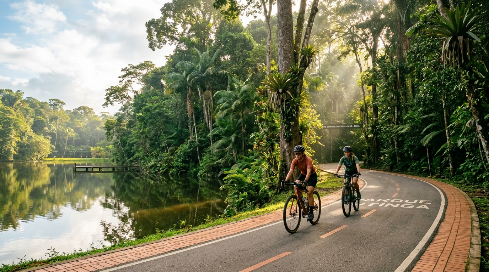
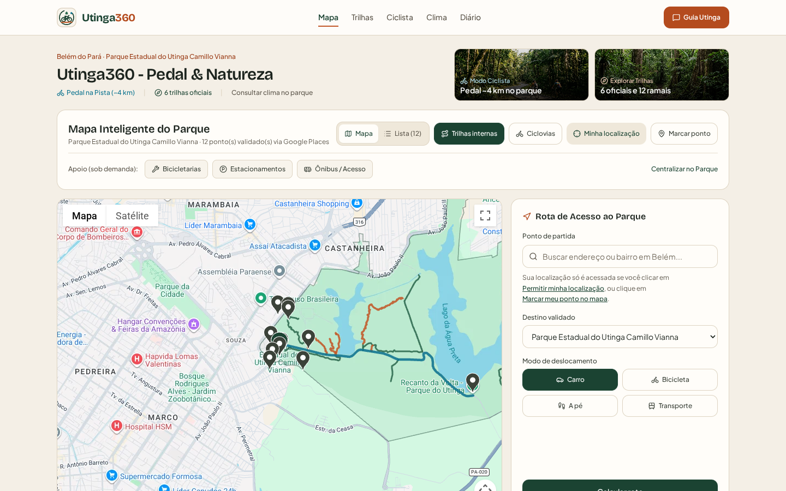
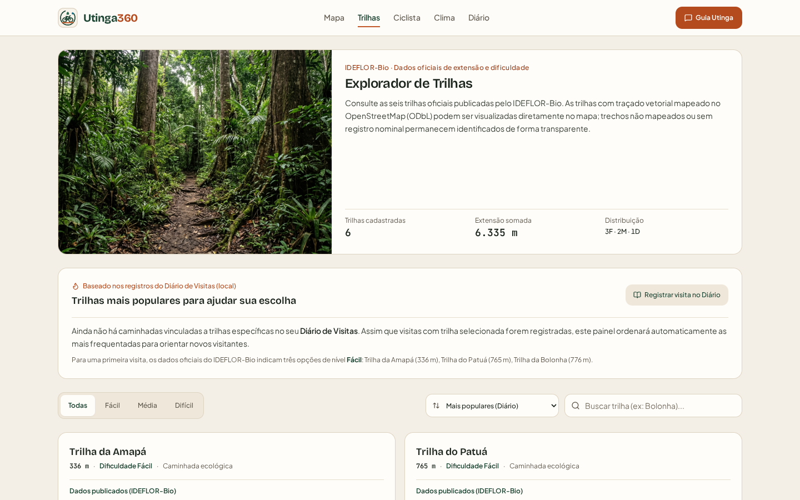
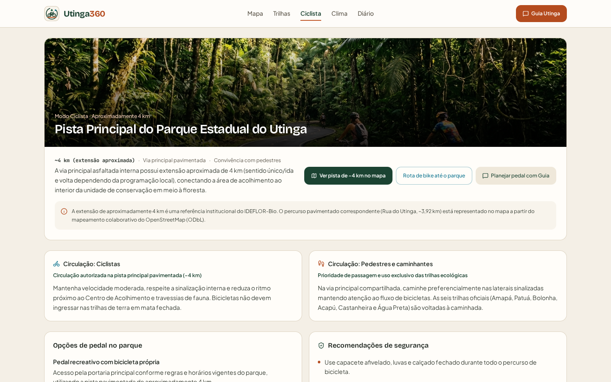
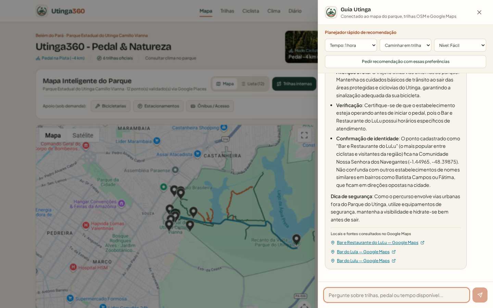

# Utinga360 - Pedal & Natureza



> **Guia inteligente, interativo e georreferenciado para visitantes, ciclistas e caminhantes do Parque Estadual do Utinga Camillo Vianna, em Belém do Pará.**

---

## Sobre a Origem do Projeto

A ideia do **Utinga360 - Pedal & Natureza** surgiu durante a minha participação no **Programa Embaixadores Estudantis Google Brasil 2026**.

Como **Embaixador Estudantil**, tenho a missão de **compartilhar conhecimento e demonstrar na prática o bom uso de ferramentas modernas de Inteligência Artificial**, mostrando como a tecnologia pode gerar impacto positivo real para a comunidade local.

Neste projeto, a IA generativa trabalha lado a lado com **dados públicos oficiais do IDEFLOR-Bio**, mapeamento colaborativo do **OpenStreetMap (ODbL)** e serviços geoespaciais da **Google Maps Platform** para transformar informações dispersas em uma experiência útil, transparente e acessível para quem pedala, caminha e preserva a natureza em **Belém do Pará**.

---

## Funcionalidades Principais

- **Mapa Inteligente do Parque**
  - Visualização interativa com limites do parque e **12 traçados georreferenciados** extraídos do OpenStreetMap (incluindo a Pista Principal pavimentada de ~4 km, Castanheira, Patuá/Patauá, Orla do Lago Bolonha, Trilha do Macaco, Mariana, Moça Bonita, Entorno do Lago Água Preta e trechos parciais de Bolonha, Acapú e Amapá).
  - Pontos de interesse validados via **Google Places API**, além de filtros sob demanda para **bicicletarias**, **estacionamentos** e **pontos de ônibus/acesso**.
  - Cálculo de **rotas de acesso** (Carro, Bicicleta, A pé e Transporte público) com **Google Routes API**, distância estimada, tempo e instruções passo a passo, usando ponto digitado, clique no mapa ou geolocalização autorizada pelo usuário.

- **Explorar Trilhas Oficiais (IDEFLOR-Bio)**
  - Catálogo completo das **6 trilhas oficiais** do parque com extensão, nível de dificuldade, resumo e transparência sobre cobertura de georreferenciamento:
    - Trilha da Amapá (`336 m` · Fácil)
    - Trilha do Patuá (`765 m` · Fácil)
    - Trilha da Bolonha (`776 m` · Fácil)
    - Trilha do Acapú (`1.142 m` · Média)
    - Trilha da Castanheira (`1.555 m` · Média)
    - Trilha da Água Preta (`1.761 m` · Difícil)
  - Filtro por dificuldade, busca textual e integração com o **Diário de Visitas** para destacar as trilhas mais registradas.

- **Modo Ciclista**
  - Informações dedicadas à **Pista Principal pavimentada (~4 km)** ligando a área de acolhimento ao Lago Bolonha / Casa da Mata.
  - Regras de circulação compartilhada entre ciclistas e pedestres, opções de pedal e recomendações de segurança e hidratação.

- **Informações Ambientais e Clima**
  - Condições atuais, sensação térmica, umidade, índice UV, visibilidade, vento e cobertura de nuvens via **Google Weather API**.
  - Previsão horária (12 h), previsão estendida (3 dias), alertas meteorológicos públicos e destaque das melhores janelas de horário para visitar.

- **Guia Utinga (Assistente IA)**
  - Assistente conversacional especializado no Parque do Utinga e acessos cicloviários/pontos de parada no entorno (como **Bar do Lulu**, portaria, lanchonetes e bicicletarias).
  - Integra os dados oficiais do IDEFLOR-Bio, as 12 trilhas do OpenStreetMap, os pontos visíveis no mapa e buscas sob demanda via **Google Places + Google Routes**.
  - Renderização segura em Markdown, botões **"Ver no mapa"** que focam a trilha mencionada e links oficiais do Google Maps como fontes consultadas.

- **Diário de Visitas**
  - Registro pessoal de passeios de bicicleta ou caminhada com data, trilha escolhida, distância e observações.
  - Dados armazenados exclusivamente no `localStorage` do navegador do visitante (sem login nem banco remoto).

---

## Capturas de Tela

### 1. Mapa Inteligente, Rotas de Acesso e Trilhas Internas
Visualização do Parque Estadual do Utinga com traçados do OpenStreetMap, pontos validados no Google Places, filtros de apoio e cálculo de rotas.



### 2. Explorador de Trilhas Oficiais (IDEFLOR-Bio)
Catálogo completo das 6 trilhas oficiais com filtro por dificuldade, extensão oficial e popularidade integrada ao Diário de Visitas.



### 3. Modo Ciclista (~4 km na Pista Principal)
Orientações dedicadas para quem vai pedalar no parque, com foco na via pavimentada, regras de convivência e recomendações de segurança.



### 4. Guia Utinga (IA conectada ao Mapa e Google Places)
Assistente conversacional que consulta as trilhas internas, pontos do mapa e rotas reais de bicicleta até paradas do entorno (como o Bar do Lulu).



---

## Stack Tecnológica

- **Frontend:** React 19, TypeScript, Tailwind CSS v4, Lucide React, `@vis.gl/react-google-maps`
- **Backend / BFF:** Node.js 22, Express 4 (`server.ts`), cache TTL em memória com deduplicação de requisições
- **IA Generativa:** `@google/genai` (Gemini API via proxy seguro no servidor com fallback automático de modelos)
- **Build & Tooling:** Vite 8, `tsx`, TypeScript (`tsc --noEmit`), `node:test`

---

## Estrutura do Projeto

```text
.
├── .github/workflows/
│   └── deploy.yml                  # Pipeline de testes, build e deploy (Cloud Run)
├── docs/
│   └── screenshots/                # Capturas de tela exibidas no README
├── public/
│   ├── assets/
│   │   ├── aistudio/               # Ilustração temática do autor
│   │   └── images/                 # Fotos do parque servidas no build de produção
│   └── favicon.svg
├── src/
│   ├── components/
│   │   ├── CyclingModeView.tsx     # Guia dedicado ao Modo Ciclista (~4 km)
│   │   ├── EnvironmentalWeatherView.tsx # Painel ambiental e previsão do tempo
│   │   ├── GuiaUtingaDrawer.tsx    # Drawer lateral do chat com o Guia Utinga
│   │   ├── MarkdownMessage.tsx     # Renderizador Markdown seguro contra XSS
│   │   ├── ParkMapWorkspace.tsx    # Mapa interativo, camadas, POIs e rotas
│   │   ├── SourcesFooter.tsx       # Seção do autor, fontes e modal de imagem
│   │   ├── TrailExplorer.tsx       # Catálogo das 6 trilhas oficiais IDEFLOR-Bio
│   │   ├── UtingaLogo.tsx          # Identidade visual e logotipo SVG
│   │   └── VisitJournalView.tsx    # Diário local de visitas e pedais
│   ├── data/
│   │   ├── internalTrailsGeo.ts    # Geometrias OSM do parque e 12 trilhas/ramais
│   │   └── parkData.ts             # Dados institucionais do IDEFLOR-Bio e ciclismo
│   ├── types/
│   │   └── app.ts                  # Tipagens compartilhadas TypeScript
│   ├── utils/
│   │   ├── apiCache.ts             # Cache TTL no servidor e navegador
│   │   ├── chatLookup.ts           # Detecção de locais e intenção de rota no chat
│   │   ├── geminiFallback.ts       # Estratégia de fallback entre modelos Gemini
│   │   ├── geolocation.ts          # Cálculos geográficos (Haversine) e GPS
│   │   ├── journal.ts              # Validação e resumo do Diário de Visitas
│   │   ├── markdown.ts             # Parser Markdown puro (AST) e sanitização de URLs
│   │   ├── polyline.ts             # Decodificador de polilinhas da Routes API
│   │   ├── trails.ts               # Filtros, estatísticas e matching de trilhas
│   │   ├── weatherFormat.ts        # Formatação pt-BR de clima e horários de Belém
│   │   └── *.test.ts               # Suíte de testes unitários (node:test)
│   ├── App.tsx                     # Shell principal, navegação e estado compartilhado
│   └── main.tsx
├── .dockerignore
├── .env.example                    # Modelo das variáveis de ambiente (sem segredos)
├── Dockerfile                      # Container pronto para produção (porta 8080/PORT)
├── index.html
├── package.json
├── server.ts                       # Servidor Express + proxy de APIs + SPA estática
└── vite.config.ts
```

---

## Fontes de Dados e Transparência

1. **IDEFLOR-Bio:** Extensões oficiais, nomes e níveis de dificuldade das 6 trilhas e referência institucional da pista principal ([página oficial](https://ideflorbio.pa.gov.br/parque-estadual-do-utinga-camillo-vianna/)).
2. **OpenStreetMap (ODbL):** Limite do Parque Estadual do Utinga (Relação `6047120`) e traçados georreferenciados das vias internas, ciclovias e trilhas mapeadas pela comunidade (`© contribuidores do OpenStreetMap`).
3. **Google Maps Platform:** Renderização de mapa base, Google Places API (New), Google Routes API e Google Weather API.
4. **Google Gemini API:** Geração de respostas do assistente **Guia Utinga** com contexto validado pelo servidor.

---

## Como Rodar Localmente

### 1. Pré-requisitos
- **Node.js 22+** e **npm**
- Chave da **Gemini API** (obtida gratuitamente no Google AI Studio)
- Chave da **Google Maps Platform** (com *Maps JavaScript API*, *Places API (New)*, *Routes API* e *Weather API* habilitadas)

### 2. Instalar dependências
```bash
npm install
```

### 3. Configurar variáveis de ambiente
Crie um arquivo `.env` na raiz a partir do `.env.example` (o `.env` já está protegido no `.gitignore` e nunca deve ser enviado ao GitHub):

```bash
cp .env.example .env
```

Preencha os valores no `.env`:
```env
GEMINI_API_KEY="sua_chave_gemini_aqui"
GEMINI_MODEL="gemini-2.5-flash"
GOOGLE_MAPS_API_KEY="sua_chave_google_maps_aqui"
VITE_GOOGLE_MAPS_API_KEY=""
VITE_GOOGLE_MAPS_MAP_ID="DEMO_MAP_ID"
```

### 4. Iniciar em desenvolvimento
```bash
npm run dev
```
Acesse `http://localhost:3000` no navegador.

---

## Scripts Disponíveis

| Comando | Descrição |
| :--- | :--- |
| `npm run dev` | Inicia o servidor Express (`server.ts`) com Vite em modo desenvolvimento na porta `3000`. |
| `npm test` | Executa toda a suíte de testes unitários (`src/utils/*.test.ts`). |
| `npm run lint` | Valida a tipagem TypeScript de todo o projeto (`tsc --noEmit`). |
| `npm run build` | Gera o bundle de produção do frontend na pasta `dist/`. |
| `npm start` | Executa o servidor em modo produção (`tsx server.ts`). |

---

## Observações sobre Publicação (Deploy)

- **GitHub Pages não executa este projeto completo**, pois ele hospeda apenas arquivos estáticos e o Utinga360 utiliza um backend Express (`server.ts`) para proteger as chaves de API nas rotas `/api/*`.
- Para publicar mantendo todas as funcionalidades, é necessário um ambiente que execute **Node.js ou Docker** (como **Render**, **Google Cloud Run**, **Railway** ou VPS), configurando `GEMINI_API_KEY` e `GOOGLE_MAPS_API_KEY` nas variáveis de ambiente da plataforma.
- O repositório já inclui `Dockerfile`, `.dockerignore` e workflow de CI/CD em `.github/workflows/deploy.yml`.

---

## Autor do Projeto


**Eric Pimentel** · *Embaixador Estudantil Google Brasil 2026* · **Belém-PA · 2026**

- **LinkedIn:** [linkedin.com/in/ericpimentel-dados](https://www.linkedin.com/in/ericpimentel-dados/)
- **Instagram:** [@eric.n.pimentel](https://www.instagram.com/eric.n.pimentel/)
- **GitHub:** [github.com/enps2015](https://github.com/enps2015)
